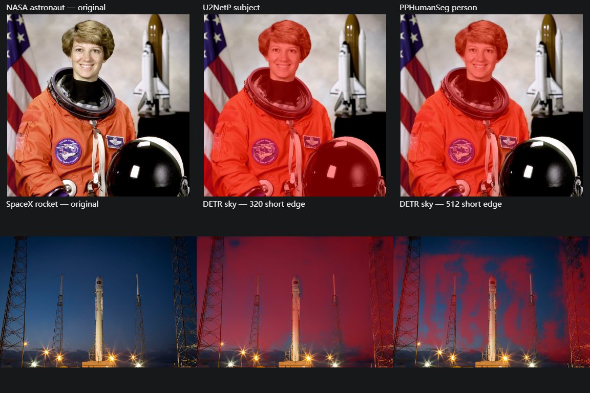

# AI segmentation investigation

Date: 2026-11-05. Actual environment: Windows, Chrome 155 headless, AMD Ryzen 7 7840U (16 reported logical processors), ONNX Runtime Web 1.31.1 WASM CPU with one thread. No GPU performance is inferred. Implementation, rights and byte delivery are documented in [AI masks](../docs/ai-masks.md).

## Selection and taxonomy

`ai/candidates.json` records inspected model revisions, byte sizes and published labels. U²-NetP is a 4.575 MB Apache-2.0 salient-object model; OpenCV Zoo PPHumanSeg is a 6.164 MB Apache-2.0 person model with explicit directory/weight licensing. They answer different questions and are not relabeled as one generic semantic classifier.

The selected optional sky provider is Xenova's **FP32** Facebook DETR ResNet-50 panoptic ONNX, 172,282,717 bytes at `ea24b2d4e0bfae31f0a1299ba3fb892a2df064de`, inherited Apache-2.0 model terms. The 44,483,407-byte quantized model was evaluated and rejected for poor coverage/artifacts. No sky weight is shipped in the application bundle. MIT sky-specific U²-Net candidates (175.997 / 88.085 MB) were assessed. NVIDIA SegFormer's original non-commercial use restriction excluded it.

The Hugging Face configuration labels **157** `sky-other`, but that legacy table does not correctly describe the panoptic weight's original COCO category IDs. Using it gave no sky (selected-class probabilities about 10⁻⁹); this failure is preserved in `ai/benchmark-sky-legacy-label.json`. Original DETR training uses annotation `category_id` directly; the original COCO table gives **187 = sky-other-merged**, **1 = person**. The exact taxonomy is retained as `web/models/COCO-PANOPTIC-CATEGORIES.json`, from revision `7bb4655548f98f3fedc07bf37e9040a992b054b0`. Correct category 187 yields a real sky query with confidence 0.9991 on the SpaceX photo.

Independent sigmoid mask outputs also leaked onto objects because panoptic query masks compete spatially. That intermediate result is retained in `ai/benchmark-sky-sigmoid-ablation.json`. The implemented soft mask sums sky probabilities after per-pixel softmax over accepted nonempty queries, matching the original panoptic competition contract while keeping soft coverage rather than final hard argmax labels.

Primary sources: [DETR dataset adapter](https://github.com/facebookresearch/detr/blob/29901c51d7fe8712168b8d0d64351170bc0f83e0/datasets/coco_panoptic.py), [panoptic postprocessing](https://github.com/facebookresearch/detr/blob/29901c51d7fe8712168b8d0d64351170bc0f83e0/models/segmentation.py), [original COCO taxonomy](https://github.com/cocodataset/panopticapi/blob/7bb4655548f98f3fedc07bf37e9040a992b054b0/panoptic_coco_categories.json), [fixed Facebook model card](https://huggingface.co/facebook/detr-resnet-50-panoptic/tree/d53b52a799403a8867920f82c869e40732b47037), [fixed ONNX conversion](https://huggingface.co/Xenova/detr-resnet-50-panoptic/tree/ea24b2d4e0bfae31f0a1299ba3fb892a2df064de).

## Actual ablations

`scripts/benchmark-ai.mjs` writes `ai/benchmark.json`; `--sky-only` writes `ai/benchmark-sky.json`. These record load/preprocessing/inference time, output dimensions/query scores, overall coverage, and soft coverage in explicitly listed manual regions. Standard normalization is compared with omitting it; Sky additionally compares 320 and 512 short-edge inputs. No graph/weight changes are made.

On the NASA astronaut, standard-normalization interior-person scores were 0.99973 (U²-NetP) and 0.98111 (PPHumanSeg), background-region scores 0.000026 / 0.000133. Omitting normalization changed person scores to 0.98251 / 0.97661 and altered total coverage. These are confidence/coverage probes, not estimated accuracy or IoU. Subject includes the held helmet, while Person largely excludes it.

CPU timing varied with load: early warm U²-NetP was 1.274 s and a later pass 2.253 s; warm PPHumanSeg 52–54 ms. The earlier full run measured Sky at 2.595 s (320 short edge) / 6.386 s (512). Latest sky-only results are in the separate JSON. Load costs are reported separately; ordinary per-job Workers incur load again. These observations are machine/fixture-specific, not latency guarantees.

The final FP32 ablation is `ai/benchmark-sky-fp32.json`. At 320 short edge, standard normalization yielded sky-region coverage 0.98592 / non-sky 0.24199 and inference 3.101 s. At **512** short edge it yielded 0.999989 / 0.012544 and 7.537 s. Omitting normalization produced no accepted sky query at either size. Production uses short-edge 512 / long-edge maximum 1024. Quantized 320 probes were 0.5637 / 0.2955; quantized 512 showed serious artifacts. Model precision and correct preprocessing mattered more than package size.

Qualitative results and manual probes still expose fine-object/tower limitations. Rectangles identify open sky and solid rocket/platform interiors; they are not exhaustive annotations. There is no dense ground truth, validation-set IoU, or cross-camera generalization claim.

The full figure originally recorded independent-sigmoid sky results. `ai/sky-qualitative.png` and `ai/benchmark-sky.json` contain quantized panoptic competition. **`ai/sky-qualitative-fp32.png` and `ai/benchmark-sky-fp32.json` are final-provider evidence.** This distinction keeps intermediate ablations separate from acceptance evidence. Browser tests exposed Chromium's serialized IndexedDB value limit (~133 MB); native integration exposed ephemeral WKWebView Blob-write failures. The final cache uses atomic 16 MB ArrayBuffer chunks and passes restart/offline reuse with Blob writes explicitly rejected in the test environment.

## Acceptance

`tests/ai-mask.test.js` passed in Windows/Chrome with the real optional weight: soft sampling; CLI target validation; actual UI Person inference; local exposure pixel change/background unchanged; original bytes unchanged; restart persistence; Subject/Background complement through forced Worker-startup fallback; actual Sky category 187; and one model download followed by cache reuse after reload. Native MyGo readiness is tested separately by the root integration task.

Fixture sources/rights are in `tests/fixtures/ai/README.md`. No personal photograph or Adobe asset is used. Digests support observational provenance; they are not model-load gates.

## First-use model transfer and worker inactivity

An Ubuntu 24.04 WSL run of the application extracted from the `205cd45` Debian package passed bundled CLI discovery, attachment, 32×24 preview readback and preservation of the 93-byte PNG. The ordinary native suite stopped on Sky with the image worker's two-minute inactivity error while the host still answered control and UI requests. A separate run of subsequent cases passed Depth and later encountered the same error during ESPCN enhancement. A direct range request to the Sky source received 4 MiB in 3.74 seconds. The endpoint observation leaves the stage of the original native timeout unresolved.

The former `Response.arrayBuffer()` path emitted no worker activity during a transfer. A controlled Chrome comparison fed the same deliberately truncated response to the real Sky, Depth and enhancement workers. With a shortened watchdog used only in the test, all three formerly returned `TIMEOUT` while the server still sent chunks. Forwarding received chunks through the shared fetch path let all three return their own model error after the response broke. The streams path preserves browser-managed buffering, backpressure and error propagation. It retains the inactivity deadline and the atomic model-cache write after a complete response. The ten-case Chrome suite also passed actual model inference, one-time caching, offline reuse and Worker fallback. [Regression](../tests/ai-mask.test.js) · [Fetch body APIs](https://fetch.spec.whatwg.org/#body-mixin) · [Transform streams](https://streams.spec.whatwg.org/#ts-model)
