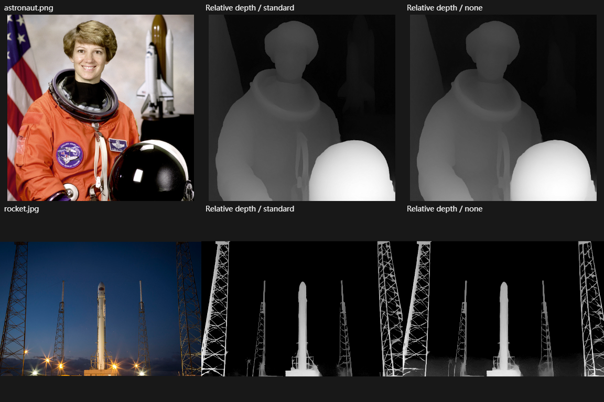

# Range and depth investigation

2026-11-05. Adobe static REA evidence identifies color/luminance/depth range and mask add/subtract/intersect entries; it does not expose their proprietary algorithms. Adobe's [desktop masking guide](https://helpx.adobe.com/lightroom/desktop/edit-photos/masking.html) confirms user-visible color/luminance ranges and intersection. OpenLR uses original coverage math described in [implementation behavior](../docs/range-depth-tools.md).

Depth source assessment: [Depth Anything V2 upstream](https://github.com/DepthAnything/Depth-Anything-V2/tree/a561b849ebae10a6f5ef49e26c83cbbcd36c71bf) explicitly licenses Small under Apache-2.0 and Base/Large/Giant under CC-BY-NC-4.0. Only Small is selected. Its [original model card](https://huggingface.co/depth-anything/Depth-Anything-V2-Small/tree/03876f8651c73a60fe4c2c48294e09fcb6838fcf) and license are retained. The [ONNX conversion](https://huggingface.co/onnx-community/depth-anything-v2-small/tree/4472b7362082ad9968fee890ca0f1e5aca36b93d) identifies that original model and Apache-2.0; its fixed preprocessor configuration is `ai/depth-preprocessor_config.json`. `ai/depth-candidates.json`, `ai/depth-weight.json` and `ai/depth-sources.json` retain versions, sizes, observed digest and source URLs. Digest is provenance, not a load gate.

The quantized graph is 27,258,801 bytes versus about 99 MB FP32. Actual inference was run in Windows Chrome 155 on Ryzen 7 7840U, one-thread ONNX Runtime Web 1.31.1 WASM CPU. `scripts/benchmark-depth.mjs` produces `ai/depth-benchmark.json` and the figure below. Standard preprocessing versus omitted mean/std is an explicit ablation on NASA astronaut and public-domain SpaceX rocket fixtures. No inference result is synthesized from those fixtures' colors or annotations.

| Fixture | Standard CPU inference | Standard relative-depth probes | No-normalization probes |
| --- | --- | --- | --- |
| NASA astronaut, 518×518 input | 3.127 s; initial load 0.711 s | person 0.25162; background 0.04460 | person 0.24610; background 0.03408 |
| SpaceX rocket, 770×518 input | 5.356 s | sky 0; rocket 0.70749; ground 0.86723 | sky 0; rocket 0.72977; ground 0.89567 |

Values are means over the normalized rectangles recorded in JSON, not accuracy/IoU or metric depth. Standard preprocessing follows the model contract even when the no-normalization ablation appears qualitatively similar. The image shows nearer helmet/towers versus distant wall/sky; the model preserves thin tower structure but cannot prove physically correct distances. There is no dense depth ground truth, multi-image validation set or cross-camera accuracy claim. Timing varies with machine/load and excludes initial network download.

Actual browser acceptance passed real model UI inference, focused-pixel identity, defocused-pixel change, range-mask probes, persisted state, cached reload, and shared inference kernel after forced Worker startup failure. Native OS acceptance is owned by the integration task; this browser result alone does not prove all WebView runtimes.
