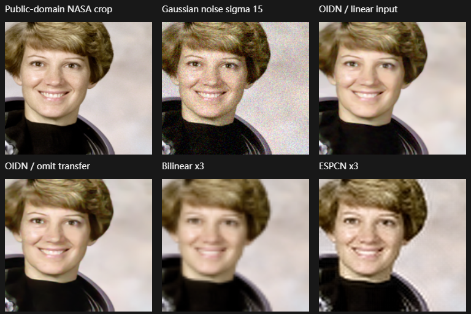

# Neural enhancement source and inference investigation

2026-11-05. This work targets disclosed **8-bit raster** enhancement, not proprietary Adobe RAW Denoise. No Adobe weights, source, binaries or photographs are distributed.

## Selected and rejected models

**Denoise:** [pmndrs/denoiser-weights at 24f30f6b04fc6e8c3b1b1993227d230d3a9344f1](https://github.com/pmndrs/denoiser-weights/tree/24f30f6b04fc6e8c3b1b1993227d230d3a9344f1) explicitly states that its converted network weights are © Intel Corporation, Apache-2.0. `rt_ldr_small.onnx` is an unmodified 1,272,337-byte conversion of original OIDN TZA weights; SHA-256 `16436607277968bbca20bb3deac330eeaec349f82b3dadcf2242dd7b2b1b7e0c`. The explicit weight grant is retained in `enhance/README.OIDN-ONNX.md`; license is `web/models/LICENSE.OIDN`. Conversion tooling is MIT, but OpenLR does not import that tooling's source. [OIDN RT documentation](https://github.com/RenderKit/oidn/blob/master/doc/api.md) and Context7 `/renderkit/oidn` establish the rendered-image task, sRGB/linear contract and tile alignment. The conversion adapter's inspected `imageOps.ts` / `engine.ts` converts sRGB inputs to linear and back; OpenLR's CPU adapter uses that contract. Fixed model bytes and provider/source revisions are in `enhance/models.json`.

**Super resolution:** [ONNX Model Zoo super-resolution-10 at 395472c4b6b92f788357237983d83fd913cfe7e3](https://huggingface.co/onnxmodelzoo/super-resolution-10/tree/395472c4b6b92f788357237983d83fd913cfe7e3) explicitly declares Apache-2.0 and provides the original ESPCN model contract/training attribution. Its unmodified weight is 240,078 bytes; SHA-256 `85f36ff88cc504a24af5e0602148bc56a8aa09a58eca8c0da2756f3e8186035e`. Model card is retained in `enhance/README.ESPCN.md`; the [original Model Zoo Apache-2.0 license](https://github.com/onnx/models/blob/c5cae0f1942c8d7727372c7b1f6b485aa39e4421/LICENSE) is retained as `web/models/LICENSE.ESPCN`. The card describes YCbCr/Y prediction and 3× output. Actual ORT run rejected 80×80 with `Expected:224`; production therefore honors the graph's fixed 224 input with reflected-context tiles. Chroma is interpolated bilinearly in OpenLR rather than claiming the card's Python bicubic implementation was copied.

Real-ESRGAN was investigated, but the [upstream weight-license clarification issue #677](https://github.com/xinntao/Real-ESRGAN/issues/677) remains a distinction from the repository's BSD-3-Clause code license. Rather than infer rights from mirror metadata, those weights were not adopted. Original DnCNN/FFDNet repositories did not provide a root LICENSE at the inspected paths; unrelated mirror MIT tags were not enough to select their weights. No noncommercial weights are used.

## Actual inference and ablations

Windows Chrome 155, Ryzen 7 7840U, ONNX Runtime Web 1.31.1 WASM CPU, one thread. `scripts/benchmark-enhance.mjs` uses a 192×192 crop of the public-domain NASA astronaut fixture, adds seeded Gaussian sRGB noise (seed 42, sigma 15), and compares outputs against the clean crop. No noisy photograph or invented model result is substituted. Super resolution downsamples the clean crop to 64×64 and compares 192×192 reconstruction against the same clean crop. `enhance/benchmark.json` records exact metrics; the figure shows all conditions.

| Condition | PSNR against clean crop | Actual CPU inference |
| --- | --- | --- |
| Added noise, no denoise | 24.984 dB | baseline |
| OIDN, standard linear transfer | 29.909 dB | 398 ms; initial session load 230 ms |
| OIDN, omitted transfer | 31.214 dB | 382 ms |
| OIDN, 64-core tiles versus 256-core | 29.910 dB | 1,218 ms, 9 tiles |
| Bilinear 3× baseline | 27.195 dB | baseline |
| ESPCN 3× | 28.209 dB | 180 ms; initial session load 12 ms |

The tiled-versus-single-core output MSE was 0.00804 RGB-byte², 69.08 dB PSNR. This bounds observed context/seam differences on this fixture; it does not prove universal tile equality. The no-transfer result is deliberately retained even though its synthetic-noise PSNR is better. The contract-consistent provider is used in production, and task/domain limitations are visible in the UI. The small ESPCN improves the tested interpolation baseline but can introduce ringing and cannot reconstruct trustworthy missing identity/text detail. No validation-set PSNR, camera-noise generalization or sensor RAW comparison is claimed. Network download time is excluded; CPU timings vary by load.

Real browser acceptance passed the Enhance dialog, OIDN noise improvement, original-byte identity, separate derived PNGs, ESPCN 3× dimensions, baked source-edit provenance, after-reload cache reuse and actual shared neural kernel after forced Worker startup failure. Native OS checks belong to integration; browser evidence does not alone establish every WebView implementation. Runtime/UI/cache behavior is documented in [Enhance](../docs/enhance.md).
